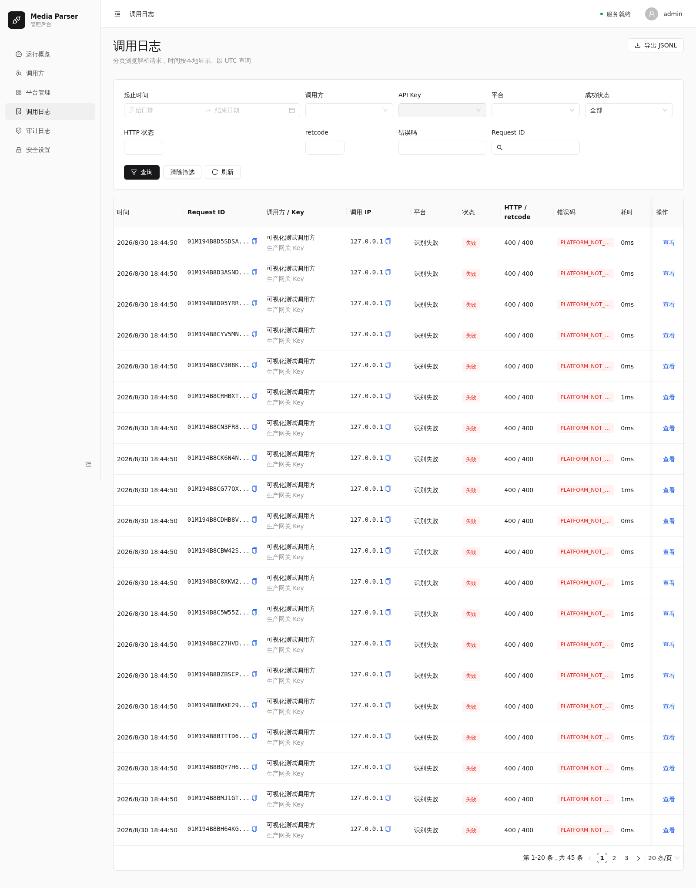

<p align="center">
  
</p>

<h1 align="center">Media Parser TS</h1>

<p align="center">
  基于 Node.js 24、TypeScript 与 Fastify 的多平台媒体原生解析服务
</p>

<p align="center">
  <a href="#核心能力">核心能力</a> ·
  <a href="#支持平台">支持平台</a> ·
  <a href="#docker-部署推荐">部署指南</a> ·
  <a href="docs/deployment.md">生产部署与 Nginx</a> ·
  <a href="#api-调用">API 调用</a> ·
  <a href="#本地开发">本地开发</a> ·
  <a href="api/openapi/openapi.yaml">OpenAPI</a>
</p>

`media-parser-ts` 参考 [ucmao/media-parser](https://github.com/ucmao/media-parser) 重构，面向自托管的网页、程序与内部服务提供统一媒体解析能力。服务会从分享文本中识别链接和平台，再由本地 TypeScript Parser 直接访问平台上游，提取视频、图集、音频、字幕或实况资源；默认不依赖第三方代解析 API。

除兼容原项目的解析响应外，本项目还提供调用方与 API Key 管理、平台凭据加密、可选动态代理池、SQLite 调用日志、运行统计、匿名解析网页和响应式管理后台。

> 本仓库当前已同步注册 **50 个 Parser**。请以本仓库的[平台定义](api/src/config/platforms.ts)和运行时 `GET /api/platforms` 为准。

## 核心能力

- **原生解析**：默认使用 TypeScript Parser，本地完成平台识别、跳转解析、请求签名和结果提取。
- **统一结果**：规范化输出标题、正文文案（`desc`）、作者、封面、视频、图集、音频、双格式字幕和 Live 实况资源。
- **两种接入方式**：提供需要 Bearer API Key 的 REST API（`/api/parse` 与兼容上游的 `/api/v1/parse`），以及无需访客输入 Key 的同源匿名网页 BFF。
- **完整管理面**：管理调用方、API Key、平台启停、9 平台加密凭据、受控实网测试、调用日志、审计与统计。
- **安全请求链与动态代理**：限制协议、端口、重定向、DNS、私网地址、响应体积和超时；支持按风控触发 15 分钟平台级代理窗口（`auto`）或轮换代理池（`always`）；请求 Cookie Jar 相互隔离。
- **可运营性**：API Key 限频与并发控制、精细化错误码、结构化脱敏日志、健康/就绪检查、SQLite WAL、优雅退出。
- **容器化部署**：API、公开页和管理后台分为三个非 root 容器，只由入口 Nginx 发布一个端口。

## 界面预览

### 公开解析页


### 管理后台

运行概览：


调用日志（调用 IP 与服务端分页）：



## 支持平台

下表表示 50 个 Parser 声明支持提取的媒体类型，不代表每条分享都一定包含对应字段。实际结果会受到内容类型、登录态、地区、时效和平台接口变化影响。

| 平台 | 视频 | 图集 | 音频 | 字幕 | 实况 | 可选凭据 |
| --- | :---: | :---: | :---: | :---: | :---: | --- |
| AcFun | ✓ | — | — | — | — | — |
| QQ音乐 | ✓ | — | ✓ | ✓ | — | — |
| Soul | ✓ | ✓ | — | — | — | — |
| 今日头条 | ✓ | ✓ | — | — | — | — |
| 全民K歌 | ✓ | — | — | — | — | — |
| 剪映 / CapCut | ✓ | ✓ | ✓ | — | — | — |
| 即梦AI | ✓ | ✓ | — | — | — | `JIMENG_COOKIE` |
| 可灵AI | ✓ | — | — | — | — | — |
| 哔哩哔哩 | ✓ | ✓ | ✓ | — | — | — |
| 央视 | ✓ | — | — | — | — | — |
| 央视频 | ✓ | ✓ | — | — | — | — |
| 夸克AI | ✓ | ✓ | — | — | — | — |
| 好看视频 | ✓ | — | — | — | — | — |
| 小云雀AI | ✓ | ✓ | — | — | — | — |
| 小红书 | ✓ | ✓ | — | — | ✓ | `XIAOHONGSHU_COOKIE` |
| 得物 | ✓ | ✓ | — | — | — | — |
| 微信公众号 | ✓ | ✓ | ✓ | — | — | — |
| 视频号 | ✓ | ✓ | ✓ | — | — | `YUANBAO_COOKIE` |
| 微博 | ✓ | ✓ | — | — | ✓ | `WEIBO_COOKIE` |
| 微视 | ✓ | — | — | — | — | — |
| 快影 | ✓ | — | ✓ | — | — | — |
| 快手 | ✓ | ✓ | ✓ | — | — | `KUAISHOU_COOKIE` |
| 抖音 | ✓ | ✓ | ✓ | ✓ | ✓ | `DOUYIN_COOKIE` |
| 拼多多 | ✓ | ✓ | ✓ | — | — | `PINDUODUO_COOKIE` |
| 新片场 | ✓ | — | — | — | — | — |
| 星绘AI | ✓ | ✓ | — | — | — | — |
| 最右 | ✓ | ✓ | — | — | ✓ | — |
| 松果时刻 | ✓ | ✓ | ✓ | — | — | — |
| 梨视频 | ✓ | — | — | — | — | — |
| 汽水音乐 | ✓ | — | ✓ | ✓ | — | — |
| 海螺AI | ✓ | ✓ | — | — | — | — |
| 番茄小说 | ✓ | — | — | — | — | — |
| 红果短剧 | ✓ | — | — | — | — | — |
| 红果漫剧 | ✓ | — | — | — | — | — |
| 皮皮搞笑 | ✓ | ✓ | — | — | — | — |
| 皮皮虾 | ✓ | ✓ | — | — | — | — |
| 知乎 | ✓ | ✓ | — | — | — | `ZHIHU_COOKIE` |
| 绿洲 | ✓ | ✓ | — | — | — | — |
| 网易LOFTER | ✓ | ✓ | — | — | — | — |
| 网易云音乐 | ✓ | ✓ | ✓ | ✓ | — | — |
| 美拍 | ✓ | — | — | — | — | — |
| 腾讯元宝 | ✓ | ✓ | — | — | — | `YUANBAO_COOKIE` |
| 腾讯频道 | ✓ | — | — | — | — | — |
| 虎牙 | ✓ | — | — | — | — | — |
| 西瓜视频 | ✓ | — | — | — | — | — |
| 豆包 | ✓ | ✓ | ✓ | — | — | `DOUBAO_COOKIE` |
| 通义千问 | ✓ | ✓ | — | — | — | — |
| 配音秀 | ✓ | — | — | — | — | — |
| 酷狗音乐 | ✓ | — | ✓ | — | — | — |
| 闲鱼 | ✓ | ✓ | — | — | — | — |

标题、正文文案、作者和封面会在平台上游能够提供时一并返回。需要登录态或风控兜底的内容可通过管理后台写入凭据；凭据使用 AES-256-GCM 加密保存，查询接口只返回掩码。环境变量也可用于受控部署，数据库中的托管凭据优先级更高。

## Docker 部署（推荐）

本节用于快速启动。包含全部环境变量、HTTPS、宿主 Nginx、升级、备份和故障处理的生产步骤见[生产部署与 Nginx 反向代理](docs/deployment.md)，可直接使用的配置见 [deploy/nginx/media-parser.conf.example](deploy/nginx/media-parser.conf.example)。

### 1. 准备配置

```bash
git clone https://github.com/x-dr/media-parser-ts.git
cd media-parser-ts
cp .env.example .env
umask 077
mkdir -p .local
chmod 700 .local
chmod 600 .env
```

编辑 `.env`，至少配置：

```dotenv
ADMIN_BOOTSTRAP_USERNAME=admin
ADMIN_BOOTSTRAP_PASSWORD=<12–128 个字符的强初始密码>
APP_ENCRYPTION_KEY=<Base64 编码的 32 字节随机密钥>
PUBLIC_WEB_API_KEY=
MEDIA_PARSER_BIND_ADDRESS=127.0.0.1
TRUST_PROXY=2
```

`APP_ENCRYPTION_KEY` 用于加密平台凭据，必须由可信的密码管理器或系统密钥工具生成并长期安全保存。不要提交 `.env`、Cookie、API Key 或 SQLite 数据库。

### 2. 拉取镜像并启动

```bash
docker compose pull
docker compose up --detach
docker compose ps
```

Compose 默认使用以下 GHCR 镜像；如需固定版本，可在 `.env` 中把对应地址的 `latest` 改成版本或 `sha-*` 标签：

- `ghcr.io/x-dr/media-parser-ts-api:latest`
- `ghcr.io/x-dr/media-parser-ts-admin:latest`
- `ghcr.io/x-dr/media-parser-ts-web:latest`

本地修改代码后仍可使用 `docker compose up --detach --build` 构建并启动。

默认入口仅绑定 `http://127.0.0.1:8051`，应由同一宿主机的 Nginx 对外提供 HTTPS：

- 公开解析页：`http://127.0.0.1:8051/`
- 管理后台：`http://127.0.0.1:8051/admin/`
- OpenAPI 文件：[api/openapi/openapi.yaml](api/openapi/openapi.yaml)

验证容器和 API：

```bash
curl --fail http://127.0.0.1:8051/healthz
curl --fail http://127.0.0.1:8051/api/health
curl --fail http://127.0.0.1:8051/api/ready
```

`/api/health` 只表示进程存活；`/api/ready` 还会检查数据库、迁移、加密密钥和全部 50 个 Parser 注册。

### GitHub Actions 镜像

仓库内的 `.github/workflows/container-images.yml` 会先检查误提交的常见敏感文件和密钥格式，再并行构建 API、Admin、Web 三个 `linux/amd64` 与 `linux/arm64` 镜像：

- `ghcr.io/x-dr/media-parser-ts-api`
- `ghcr.io/x-dr/media-parser-ts-admin`
- `ghcr.io/x-dr/media-parser-ts-web`

Pull Request 只验证构建，不推送镜像；推送到 `main`、推送 `v*` 版本标签或手动运行工作流时，会使用仓库自带的 `GITHUB_TOKEN` 发布到 GHCR，不需要另存用户名或 Registry Token。镜像包含分支、语义化版本和提交 SHA 标签，并生成 provenance 与 SBOM。

### 3. 初始化公开解析页

首次登录管理后台时，使用 `.env` 中的管理员用户名和初始密码。系统会要求立即修改初始密码。

随后在后台完成以下操作：

1. 创建用途为 `public-web` 的调用方。
2. 为它创建 API Key，并立即安全保存只展示一次的完整 `mp_...` Key。
3. 将这个 Key 写入 `.env` 的 `PUBLIC_WEB_API_KEY`。
4. 重新创建 API 容器并检查匿名网页状态。

```bash
docker compose up --detach --force-recreate
curl --fail http://127.0.0.1:8051/web-api/status
```

公开网页的 Key 只存在服务端，不能放入 `VITE_*`、HTML、前端 JavaScript 或浏览器存储。外部程序调用 `/api/parse` 或 `/api/v1/parse` 时应创建另一个调用方和独立 Key，避免与公开网页共享配额和吊销范围。

### 容器拓扑

| 外部路径 | 内部目标 |
| --- | --- |
| `/`、`/assets/` | Web Nginx 静态资源与 SPA 回退 |
| `/admin/` | Admin Nginx |
| `/api/`、`/web-api/` | Fastify API |
| `/healthz` | 入口 Nginx 健康检查 |

Compose 只发布 `${MEDIA_PARSER_PORT:-8051}`，API 与 Admin 不直接暴露宿主端口。SQLite 数据保存在 `media-parser-data` 命名卷。

生产环境保持 `MEDIA_PARSER_BIND_ADDRESS=127.0.0.1`，并按[配置示例](deploy/nginx/media-parser.conf.example)把域名反向代理到 `127.0.0.1:8051`。此时请求经过宿主与容器内两层 Nginx，`TRUST_PROXY` 应为 `2`；若在可信局域网直接访问 Compose 入口，则改为 `MEDIA_PARSER_BIND_ADDRESS=0.0.0.0` 和 `TRUST_PROXY=1`。

## API 调用

### 健康检查

```http
GET /api/health
```

```json
{
  "status": "ok"
}
```

### 媒体解析（`/api/parse` 与 `/api/v1/parse`）

所有解析接口均强制使用 `Authorization: Bearer mp_<key-id>_<secret>` 请求头鉴权（不接受 URL 查询参数传递 Key）：

- `POST /api/parse`：严格 JSON 请求体 `{ "text": "..." }`
- `GET /api/v1/parse?url=...`（或 `?text=...`）：兼容上游 v1 GET 调用
- `POST /api/v1/parse`：兼容 JSON 或 `application/x-www-form-urlencoded` 表单（支持 `url` 或 `text` 字段）

```bash
curl --fail-with-body http://127.0.0.1:8051/api/parse \
  --request POST \
  --header 'Content-Type: application/json' \
  --header "Authorization: Bearer ${MEDIA_PARSER_API_KEY}" \
  --data '{"text":"这里替换为分享文本或链接"}'

curl --fail-with-body --get http://127.0.0.1:8051/api/v1/parse \
  --header "Authorization: Bearer ${MEDIA_PARSER_API_KEY}" \
  --data-urlencode 'url=https://v.douyin.com/...'
```

成功响应沿用并扩展上游的数据外壳：

```json
{
  "retcode": 200,
  "retdesc": "成功",
  "data": {
    "video_id": "7123...",
    "platform": "抖音",
    "title": "作品标题",
    "desc": "作品正文文案",
    "video_url": "https://...",
    "audio_url": "https://...",
    "cover_url": "https://...",
    "author": {
      "nickname": "作者昵称",
      "author_id": "作者 ID",
      "avatar": "https://..."
    },
    "image_list": [],
    "subtitles": [
      {
        "text": "字幕/歌词内容",
        "start": 0.64,
        "end": 2.12,
        "start_ms": 640,
        "end_ms": 2120
      }
    ]
  },
  "succ": true
}
```

多视频内容额外返回 `video_list`，试听截断音乐额外返回 `is_preview: true` 与 `full_duration`，实况图片项使用 `{ "url", "live_photo_url" }` 结构。

失败响应示例（含私密/删除、纯文本对话、凭据缺失与代理耗尽等精细化错误码）：

```json
{
  "retcode": 400,
  "retdesc": "该链接尚未支持提取",
  "data": null,
  "succ": false,
  "error_code": "PLATFORM_NOT_SUPPORTED"
}
```

解析 API 必须使用 `mp_...` API Key。管理员登录获得的 `ma_access_...` Token 只用于 `/api/admin/v1/*`，不能替代调用方 Key。完整管理 API 契约见 [OpenAPI 3.1 文档](api/openapi/openapi.yaml)。

## 本地开发

### 环境要求

- Node.js `>=24 <25`
- Corepack
- pnpm `11.21.0`（由根目录 `packageManager` 锁定）
- Linux 环境需要具备编译 `better-sqlite3` 的工具链

```bash
corepack enable
pnpm install --frozen-lockfile
```

不要使用其他 Node 主版本重新生成 lockfile。

### 本地配置

复制配置后，将容器路径改为宿主机可写路径：

```dotenv
PORT=8051
LOG_LEVEL=debug
DATABASE_PATH=.local/media-parser.sqlite
ADMIN_BOOTSTRAP_USERNAME=admin
ADMIN_BOOTSTRAP_PASSWORD=<12–128 个字符的强初始密码>
APP_ENCRYPTION_KEY=<Base64 编码的 32 字节随机密钥>
```

开发和启动命令会自动读取根目录 `.env`。首次数据库初始化后，环境变量不会覆盖已有管理员；`.env` 应保持 `0600` 权限。

### 启动服务

分别在三个终端运行：

```bash
# Fastify API，文件变化时自动重启
pnpm dev

# 管理后台：http://127.0.0.1:5173/admin/
pnpm dev:admin

# 公开解析页：http://127.0.0.1:5174/
pnpm dev:web
```

两个 Vite 开发服务器都会把 API 请求代理到 `127.0.0.1:8051`。管理后台会话只保存在页面内存中；公开页不会要求访客输入或保存 API Key。

### 调试与检查

```bash
# 在 127.0.0.1:9229 开启 Node Inspector
pnpm debug

# 代码质量与测试
pnpm lint
pnpm typecheck
pnpm test
pnpm build
pnpm check
```

运行单个测试文件：

```bash
pnpm --filter @media-parser/api exec vitest run tests/contract/public-api.test.ts
```

## 项目结构

```text
media-parser-ts/
├── api/
│   ├── src/api/             # 公开 API（/api/parse、/api/v1/parse）与管理员 API
│   ├── src/core/            # Parser 注册、代理重试解析流程与统一结果
│   ├── src/http/            # HTTP 会话、动态代理池、重定向与出站安全策略
│   ├── src/platforms/       # 50 个平台 TypeScript Parser
│   ├── src/signers/         # 字节系与拼多多本地可信签名器
│   ├── src/database/        # SQLite、迁移与 Repository
│   ├── src/security/        # 凭据加密与隔离挑战
│   ├── tests/               # 单元、契约、安全与平台测试
│   └── openapi/             # OpenAPI 3.1 契约
├── admin/                   # React 19 + Ant Design 6 管理后台
├── web/                     # React 19 + Ant Design 6 公开解析页
├── platform-icons/          # 50 平台图标与品牌色回退包
├── deploy/nginx/            # 宿主 Nginx HTTP/HTTPS 反向代理示例
├── docs/                    # 重构设计、进度与界面设计资料
├── compose.yaml             # API + Admin + Web 编排
└── package.json             # pnpm workspace 统一入口
```

## 配置参考

| 变量 | 默认值 | 说明 |
| --- | --- | --- |
| `PORT` | `8051` | API 监听端口 |
| `MEDIA_PARSER_BIND_ADDRESS` | `127.0.0.1` | Compose 宿主绑定地址；Nginx 同机部署应保持回环地址 |
| `MEDIA_PARSER_PORT` | `8051` | Compose 发布到宿主机的端口 |
| `LOG_LEVEL` | `info` | `fatal/error/warn/info/debug/trace/silent` |
| `DATABASE_PATH` | `/app/data/media-parser.sqlite` | SQLite 路径；宿主开发建议 `.local/media-parser.sqlite` |
| `PARSE_TIMEOUT_MS` | `25000` | 单次完整解析超时，范围 1–120 秒 |
| `UPSTREAM_TIMEOUT_MS` | `10000` | 单个上游请求超时，范围 0.5–60 秒 |
| `GLOBAL_PARSE_CONCURRENCY` | `20` | 服务全局解析并发上限 |
| `PUBLIC_WEB_API_KEY` | 无 | 匿名网页 BFF 的专用 `mp_...` Key，只能保存在服务端 |
| `PUBLIC_WEB_CONCURRENCY` | `8` | 匿名网页独立全局并发上限 |
| `PUBLIC_WEB_RATE_LIMIT_PER_MINUTE` | `6` | 每个可信访客 IP 每分钟请求数 |
| `LOG_RETENTION_DAYS` | `30` | 调用日志保留天数 |
| `ADMIN_BOOTSTRAP_USERNAME` | 无 | 仅首次建库时创建管理员 |
| `ADMIN_BOOTSTRAP_PASSWORD` | 无 | 仅首次建库时使用的初始密码，12–128 个字符 |
| `APP_ENCRYPTION_KEY` | 无 | 当前 Base64 32 字节平台凭据密钥 |
| `APP_ENCRYPTION_KEY_PREVIOUS` | 无 | 密钥轮换期间用于解密旧数据 |
| `CORS_ORIGINS` | 空 | 逗号分隔的精确 HTTP(S) Origin，不支持通配符 |
| `TRUST_PROXY` | `false` | `false`、可信代理跳数或可信地址列表，不能写 `true`；本文生产拓扑使用 `2` |
| `DYNAMIC_PROXY_API_URL` | 无 | 动态代理提取接口地址（支持主流代理商 JSON 与 `IP:端口` 纯文本） |
| `PROXY_MODE` | `auto` | `auto`（风控触发 15 分钟平台级代理窗口）或 `always`（每次解析轮换代理池） |
| `PROXY_POOL_SIZE` | `2` | 同时保留的可分配代理 IP 数（1–100） |
| `PROXY_FETCH_PER_SECOND` | `1` | 全服务每秒最多调用代理提取接口次数（1–20） |
| `PARSER_ENGINE` | `typescript` | `typescript` 或全局回滚模式 `legacy-http` |
| `LEGACY_PYTHON_URL` | 无 | `legacy-http` 模式下自托管 Python 服务的根 URL |
| `DOUBAO_COOKIE` | 空 | 可选豆包 Cookie |
| `YUANBAO_COOKIE` | 空 | 可选腾讯元宝 / 视频号 Cookie（别名 `WECHAT_CHANNELS_COOKIE`） |
| `KUAISHOU_COOKIE` | 空 | 可选快手 Cookie（别名 `KS_COOKIE`） |
| `XIAOHONGSHU_COOKIE` | 空 | 可选小红书 Cookie（别名 `XHS_COOKIE`） |
| `DOUYIN_COOKIE` | 空 | 可选抖音 Cookie（别名 `DY_COOKIE`，实况动轨可额外配置 `DOUYIN_UIFID`） |
| `PINDUODUO_COOKIE` | 空 | 可选拼多多 Cookie（别名 `PDD_COOKIE`，用于多多视频） |
| `WEIBO_COOKIE` | 空 | 可选微博 Cookie |
| `JIMENG_COOKIE` | 空 | 可选即梦 AI Cookie |
| `ZHIHU_COOKIE` | 空 | 可选知乎 Cookie |

`legacy-http` 是整体回滚开关，不支持按平台分流。启用后，Node 服务仍负责鉴权、限流、并发、平台启停和调用日志，再将解析请求转发给你自行部署的 Python 服务。

## 与原项目的关系

- 上游 [ucmao/media-parser](https://github.com/ucmao/media-parser) 是本项目的 Python 参考实现和协议行为基线。
- 本项目默认执行独立的 TypeScript Parser，不会在后台调用公共第三方解析服务。
- `/api/parse` 与 `/api/v1/parse` 保留上游的 `retcode`、`retdesc`、`data`、`succ` 响应风格，同时维持严格的 Bearer API Key 鉴权和运营控制。
- 更多实现边界与验收状态见[重构设计](docs/nodejs-typescript-refactor-design.md)和[当前进度](docs/PROGRESS.md)。

## 使用声明

本项目仅用于合法的学习、研究和自托管集成。请只解析你有权访问和使用的公开或已授权内容，并遵守目标平台服务条款、版权规则及所在地法律法规。媒体直链可能带有时效或访问限制，不应被视为永久存储地址。

感谢 [ucmao/media-parser](https://github.com/ucmao/media-parser) 及其贡献者提供的原始实现与文档。使用或分发衍生内容时，请同时查阅上游的 [LICENSE](https://github.com/ucmao/media-parser/blob/main/LICENSE)。本仓库问题请提交到 [x-dr/media-parser-ts Issues](https://github.com/x-dr/media-parser-ts/issues)。
